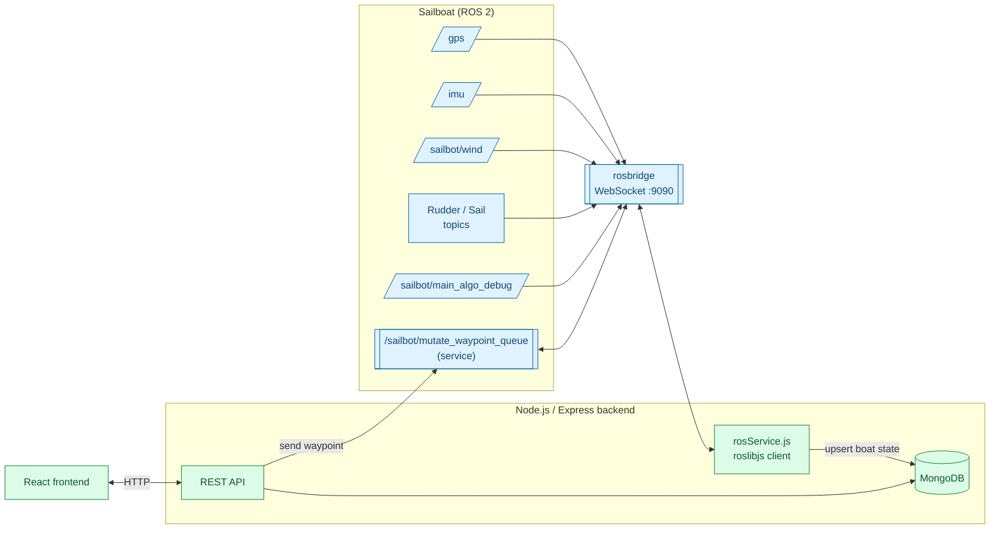

# ⛵ Sailbot Webstack

A full-stack ground-control web application for an autonomous sailboat — bridging a live ROS 2 stack to a browser so a human operator can watch telemetry, drop waypoints, and mark buoys in real time.

**Backend**
&nbsp;


**Frontend**
&nbsp;


**Robotics bridge**
&nbsp;


---

## Table of contents

- [The Problem](#the-problem)
- [What it does](#what-it-does)
- [Architecture](#architecture)
- [Tech Stack](#tech-stack)
- [Repository Layout](#repository-layout)
- [Quick Start](#quick-start)
- [API Reference](#api-reference)
- [Data Model](#data-model)
- [Limitations](#limitations)
- [Roadmap](#roadmap)
- [License](#license)

---

## The Problem

An autonomous sailboat's ROS 2 stack — GPS, IMU, sail/rudder servos, wind sensor, autopilot ("algo") — speaks in ROS topics and services over a `rosbridge` WebSocket. That's not something a human operator on shore can watch or steer through directly. Someone monitoring a run, or planning a mission, needs a normal web page: a map, some dials, a way to drop waypoints, and confidence that what they're looking at is the boat's actual current state.

## What it does

- **Bridges ROS to HTTP.** A persistent `roslibjs` connection subscribes to the boat's live topics (`/gps`, `/imu`, `/sailbot/wind`, `/sailbot/control_mode`, `/sailbot/algo_rudder`, `/sailbot/algo_sail`, `/sailbot/actual_rudder_angle`, `/sailbot/actual_sail_angle`, `/sailbot/dropped_packets`, `/sailbot/main_algo_debug`) and folds every update into one "current boat state" document.
- **Persists boat state.** Instead of the frontend talking to ROS directly, it polls a REST API backed by MongoDB — so the latest GPS position, heading, rudder/sail angles (target vs. actual vs. radio vs. autopilot), tacking state, and dropped-packet count are always one `GET /api/boat` away.
- **Manages a waypoint queue.** Waypoints are validated (valid lat/lng), persisted, ordered, reorderable, and pushed to the robot via a ROS service call (`/sailbot/mutate_waypoint_queue`) — if the robot is unreachable, the waypoint still saves to the DB so the mission queue isn't lost.
- **Manages buoys.** Simple CRUD for marking buoy positions on the map (e.g. for course marking or obstacle avoidance).
- **Exposes bridge health.** `GET /api/ros/status` reports whether the backend currently has a live rosbridge connection.

## Architecture



Boat telemetry flows one way — ROS → backend → DB → frontend (poll) — so the frontend never needs a direct ROS connection. Waypoint creation flows the other way too: frontend → REST → DB (always) → ROS service call (best-effort, boat may be offline).

## Tech Stack

| Layer | Technology | Role |
|---|---|---|
| Backend | [Express](https://expressjs.com) on Node.js | REST API, CORS-enabled for the frontend |
| Database | [MongoDB](https://www.mongodb.com) via [Mongoose](https://mongoosejs.com) | Persists boat state, waypoints, buoys |
| ROS bridge | [roslibjs](https://github.com/RobotWebTools/roslibjs) + [rosbridge_suite](http://wiki.ros.org/rosbridge_suite) | WebSocket client subscribing to boat topics and calling the waypoint-queue service |
| Frontend | [React](https://react.dev) (Create React App) | Map, dials, and waypoint/buoy controls for the operator *(in progress)* |

## Repository Layout

```
sailbot-webstack/
├── backend/
│   ├── src/
│   │   ├── server.js              # entrypoint: connects DB + ROS, starts Express
│   │   ├── app.js                 # Express app, middleware, route mounting
│   │   ├── config/db.js           # MongoDB connection
│   │   ├── models/
│   │   │   ├── Boat.js            # single-document "current state" schema
│   │   │   ├── Buoy.js
│   │   │   └── Waypoint.js
│   │   ├── routes/
│   │   │   ├── boatRoutes.js      # GET / POST update / DELETE reset
│   │   │   ├── buoyRoutes.js      # GET / POST add / DELETE
│   │   │   ├── waypointRoutes.js  # GET / POST / PUT reorder / DELETE
│   │   │   └── rosRoutes.js       # GET status
│   │   └── services/
│   │       └── rosService.js      # roslibjs subscriptions + waypoint service client
│   └── package.json
└── frontend/                      # React app (Create React App scaffold)
```

## Quick Start

### Prerequisites

- Node.js 18+
- A running MongoDB instance on `mongodb://127.0.0.1:27017`
- A `rosbridge_suite` WebSocket server reachable at `ws://localhost:9090` (or set `ROSBRIDGE_URL`)

### Backend

```bash
cd backend
npm install
npm start   # or: node src/server.js
# → http://localhost:5000
```

### Frontend

```bash
cd frontend
npm install
npm start
# → http://localhost:3000
```

## API Reference

| Method | Path | Description |
|---|---|---|
| `GET` | `/api/boat` | Latest boat state (position, heading, rudder/sail angles, wind, mode) |
| `POST` | `/api/boat/update` | Upsert boat telemetry (used internally by the ROS bridge) |
| `DELETE` | `/api/boat/reset` | Clear boat state (new run) |
| `GET` | `/api/buoy` | List all buoys |
| `POST` | `/api/buoy/add` | Add a buoy at `{ latitude, longitude }` |
| `DELETE` | `/api/buoy/reset` | Clear all buoys |
| `DELETE` | `/api/buoy/:id` | Remove one buoy |
| `GET` | `/api/waypoints` | List waypoints, ordered |
| `POST` | `/api/waypoints` | Add a waypoint; also pushed to the robot over ROS (best-effort) |
| `PUT` | `/api/waypoints/reorder` | Reorder waypoints given an array of IDs |
| `DELETE` | `/api/waypoints/clear` | Clear the whole mission |
| `DELETE` | `/api/waypoints/:id` | Remove one waypoint |
| `GET` | `/api/ros/status` | Whether the rosbridge connection is currently up |

## Data Model

**Boat** is a single "current state" document, continuously upserted from ROS — not a time-series log. It tracks rudder and sail angle from four independent sources (web UI target, servo feedback, handheld radio, and autopilot), plus heading, wind angle, control mode, tacking state, distance to destination, and dropped-packet count.

**Waypoint** and **Buoy** are simple geo-tagged documents; waypoints additionally carry an `order` field for drag-and-drop mission sequencing.

## Limitations

- Boat state is a single upserted document, not a history — there's no built-in telemetry log/replay yet.
- Waypoint delivery to the robot is best-effort: if `rosbridge` is down, the waypoint is saved to Mongo but not pushed, and there's no automatic re-sync once the connection returns.
- The frontend is still an unmodified Create React App scaffold — the map, dial, and waypoint UI that consumes this API hasn't been built out yet.
- No authentication on the API; assumes a trusted local/LAN operator setup.

## Roadmap

- Build out the React frontend: live map, instrument dials, waypoint drag-and-drop, buoy markers
- Auto-resync the waypoint queue to the robot when the ROS connection is re-established
- Telemetry history/logging for post-run analysis
- Basic auth for the operator API

## License

MIT
