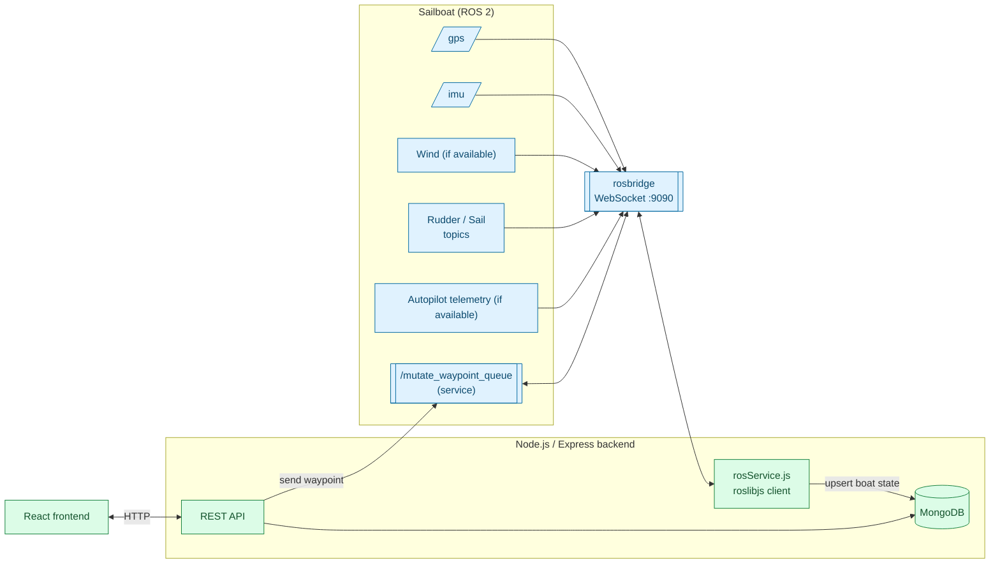

# ⛵ Webstack

A full-stack ground-control web application for an autonomous sailboat — bridging a live ROS 2 stack to a browser so a human operator can watch telemetry, drop waypoints, and mark buoys in real time.

**Backend**
&nbsp;


**Frontend**
&nbsp;


**Robotics bridge**
&nbsp;


---

## Table of contents

- [The Problem](#the-problem)
- [What it does](#what-it-does)
- [Architecture](#architecture)
- [Tech Stack](#tech-stack)
- [Repository Layout](#repository-layout)
- [Quick Start](#quick-start)
- [API Reference](#api-reference)
- [Data Model](#data-model)
- [Limitations](#limitations)
- [Roadmap](#roadmap)
- [License](#license)

---

## The Problem

An autonomous sailboat's ROS 2 stack — GPS, IMU, sail/rudder servos, wind sensor, autopilot ("algo") — speaks in ROS topics and services over a `rosbridge` WebSocket. That's not something a human operator on shore can watch or steer through directly. Someone monitoring a run, or planning a mission, needs a normal web page: a map, some dials, a way to drop waypoints, and confidence that what they're looking at is the boat's actual current state.

## What it does

- **Bridges ROS to HTTP.** A persistent `roslibjs` connection subscribes to the boat's live actuator topics (`/actual_rudder_angle`, `/actual_mainsail_angle`, `/dropped_packets`) and folds every update into one "current boat state" document. Additional telemetry subscriptions depend on which nodes the connected ROS stack provides; see `backend/src/services/rosService.js` for the configured topics.
- **Persists boat state.** Instead of the frontend talking to ROS directly, it polls a REST API backed by MongoDB — so the latest GPS position, heading, rudder/sail angles (target vs. actual vs. radio vs. autopilot), tacking state, and dropped-packet count are always one `GET /api/boat` away.
- **Manages a waypoint queue.** The boat owns the active queue. The backend reads it every second into MongoDB for dashboard polling and offline viewing. Online edits use `/mutate_waypoint_queue`; a version check rejects edits if the boat advanced during the request.
- **Manages buoys.** Simple CRUD for marking buoy positions on the map (e.g. for course marking or obstacle avoidance).
- **Exposes bridge health.** `GET /api/ros/status` reports whether the backend currently has a live rosbridge connection.

## Architecture



Boat telemetry flows one way — ROS → backend → DB → frontend (poll) — so the frontend never needs a direct ROS connection. Waypoint edits flow frontend → REST → ROS → DB after boat acknowledgement. Background reads flow ROS → DB → frontend. MongoDB stores the last confirmed queue and is never pushed back to restore the boat.

## Tech Stack

| Layer | Technology | Role |
|---|---|---|
| Backend | [Express](https://expressjs.com) on Node.js | REST API, CORS-enabled for the frontend |
| Database | [MongoDB](https://www.mongodb.com) via [Mongoose](https://mongoosejs.com) | Persists boat state, waypoints, buoys |
| ROS bridge | [roslibjs](https://github.com/RobotWebTools/roslibjs) + [rosbridge_suite](http://wiki.ros.org/rosbridge_suite) | WebSocket client subscribing to boat topics and calling the waypoint-queue service |
| Frontend | [React](https://react.dev) + Vite | Map, dials, and waypoint/buoy controls for the operator *(in progress)* |

## Repository Layout

```
webstack/
├── backend/
│   ├── src/
│   │   ├── server.js              # entrypoint: connects DB + ROS, starts Express
│   │   ├── app.js                 # Express app, middleware, route mounting
│   │   ├── config/db.js           # MongoDB connection
│   │   ├── models/
│   │   │   ├── Boat.js            # single-document "current state" schema
│   │   │   ├── Buoy.js
│   │   │   └── Waypoint.js
│   │   ├── routes/
│   │   │   ├── boatRoutes.js      # GET / POST update / DELETE reset
│   │   │   ├── buoyRoutes.js      # GET / POST add / DELETE
│   │   │   ├── waypointRoutes.js  # GET / POST / PUT reorder / DELETE
│   │   │   └── rosRoutes.js       # GET status
│   │   └── services/
│   │       └── rosService.js      # roslibjs subscriptions + waypoint service client
│   └── package.json
└── frontend/                      # React dashboard (Vite)
```

## Quick Start

### Prerequisites

- Node.js 22.22.2+, 24.15.0+, or 26+ (required by the frontend tooling)
- [MongoDB Community Server](https://www.mongodb.com/docs/manual/installation/) installed locally
- A `rosbridge_suite` WebSocket server reachable at `ws://localhost:9090` (or set `ROSBRIDGE_URL`)

Run each section in a separate terminal, starting from the repository root.

### Backend

Start your MongoDB server at `127.0.0.1:27017`. If on macOS and MongoDB was installed with Homebrew, you can do so with:

```bash
brew services start mongodb-community
```

```bash
cd backend
npm install
npm start   # or: node src/server.js
# → http://localhost:5001
```

### Frontend

For the map, create `frontend/.env` with `VITE_GOOGLE_MAPS_API_KEY=your-key-here`
(see `frontend/.env.example`). Restart the frontend after changing this file.

```bash
cd frontend
npm install
npm start
# → http://localhost:3000
```

Open that URL in your browser. Vite forwards `/api` requests to port 5001;
both ports must be available. From `frontend/`, use `npm test` for a single
test run, `npm run test:watch` for watch mode, and `npm run build` to produce
`build/`.

## API Reference

| Method | Path | Description |
|---|---|---|
| `GET` | `/api/boat` | Latest boat state (position, heading, rudder/sail angles, wind, mode) |
| `POST` | `/api/boat/update` | Upsert boat telemetry (used internally by the ROS bridge) |
| `DELETE` | `/api/boat/reset` | Clear boat state (new run) |
| `GET` | `/api/buoy` | List all buoys |
| `POST` | `/api/buoy/add` | Add a buoy at `{ latitude, longitude }` |
| `DELETE` | `/api/buoy/reset` | Clear all buoys |
| `DELETE` | `/api/buoy/:id` | Remove one buoy |
| `GET` | `/api/waypoints` | Last confirmed waypoints from MongoDB, ordered |
| `POST` | `/api/waypoints` | Append to the live boat queue; HTTP 201 means the boat accepted it |
| `GET` | `/api/waypoints/status` | `{connected, stale, confirmedAt, error}` cache status |
| `PUT` | `/api/waypoints/reorder` | Reorder waypoints given an array of IDs |
| `DELETE` | `/api/waypoints/clear` | Clear the whole mission |
| `DELETE` | `/api/waypoints/:id` | Remove one waypoint |
| `GET` | `/api/ros/status` | Whether the rosbridge connection is currently up |

## Data Model

Heading is in degrees in [-180, 180): 0=east, 90=north, -180=west, -90=south, increasing counter-clockwise. The backend stores `/imu.z` unchanged; the map marker and heading dial convert to screen rotation only when rendering. Relative wind and actuator angles retain their hardware reference frames.

**Boat** is a single "current state" document, continuously upserted from ROS — not a time-series log. It tracks rudder and sail angle from four independent sources (web UI target, servo feedback, handheld radio, and autopilot), plus heading, wind angle, control mode, tacking state, distance to destination, and dropped-packet count.

**WaypointQueue** stores the boat's last confirmed ordered queue and `confirmedAt` in MongoDB, refreshed every second.

## Limitations

- Boat state is a single upserted document, not a history — there's no built-in telemetry log/replay yet.
- Waypoint edits require a live boat connection. A stale saved queue is only for offline viewing.
- Queue operations assume one backend process; multiple backend writers are unsupported.
- No authentication on the API; assumes a trusted local/LAN operator setup.

## Roadmap

- Build out the React frontend: live map, instrument dials, waypoint drag-and-drop, buoy markers
- Telemetry history/logging for post-run analysis
- Basic auth for the operator API

## License

MIT
